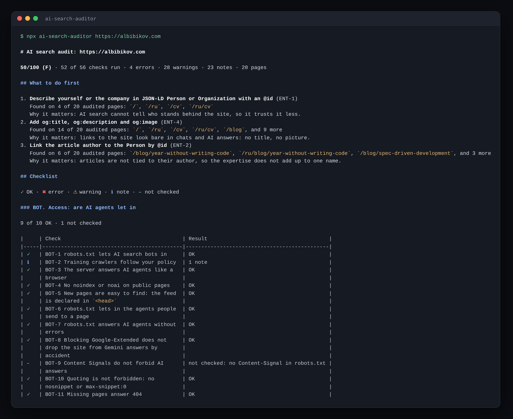

# ai-search-audit

[](https://www.npmjs.com/package/ai-search-auditor) [](https://github.com/a-bibikov/ai-search-audit)

**Can ChatGPT, Claude and Perplexity read, understand and cite your site?** One command checks what AI search actually sees: whether AI agents are let in, the text without JavaScript, who stands behind the site in JSON-LD, whether the answer sits where it gets quoted, `llms.txt`, freshness, and content that answer engines treat as prompt injection. 57 checks, each with what it costs and how to fix it.

```bash
npx ai-search-auditor https://example.com
```



No sign-up, no API keys. Node.js 22.18+.

If it saved you time, a ⭐ on [GitHub](https://github.com/a-bibikov/ai-search-audit) helps other people find it.

The npm package is `ai-search-auditor`; once installed (`npm i -g ai-search-auditor`), the command is also available as `ai-search-audit`.

## Why this matters now

People increasingly get answers from ChatGPT, Claude, Perplexity and Google AI Overviews instead of a list of links. An answer engine reads a handful of pages, picks a few sources and cites them. The rest of the web does not exist for that answer.

Whether your site is among those sources depends on things classic SEO tools rarely look at: whether AI agents are let in, whether the text is there without JavaScript, whether the model can tell who the author is, whether the answer sits where it gets quoted. A site can rank well in Google and still be invisible, misread or skipped by AI search. Most of these problems are a few lines of code to fix, once you know they are there.

## Why another GEO checker

Most GEO / AI SEO checkers score a checklist: "is there an FAQ?", "are AI bots named in robots.txt?". They miss what breaks citations in practice and raise alarms that are not problems. This one reads the site the way a model does:

- **Reads like a model.** It looks at the HTML without JavaScript and at machine-readable output: headings that glue words together (`NameTagline`), invisible characters that split «AI-native» in a feed, an author in articles that points at no defined person, lines in `llms.txt` addressed to AI agents.
- **No false alarms.** A rule fires on a fact in the HTML or a server response, not on a guess. Heuristics are `info` and say "check by hand". Every rule is tested on a site where it must fire and on one where it must stay silent.
- **Explains the consequence.** Each finding says what AI search will not be able to do and how to fix it in code.
- **CI first.** Exit code, a GitHub Action and a report in the PR summary, so a fix does not regress.
- **Multilingual sites.** hreflang, `llms.txt` per language, `inLanguage`.

## What it checks

57 checks in seven groups.

**BOT. Access: are AI agents let in**
- **BOT-1** AI search bots — OAI-SearchBot, Claude-SearchBot, PerplexityBot, Googlebot, Bingbot, Applebot and others — may read the site
- **BOT-2** Training crawlers are allowed or blocked the way you intend
- **BOT-3** The server answers AI agents the same way it answers a browser: no errors, no bot checks, no stripped pages
- **BOT-4** Public pages are not marked as closed to indexing or AI
- **BOT-5** The news feed can be found from the pages
- **BOT-6** The agents people send to a page — ChatGPT-User, Claude-User, Perplexity-User and others — may read it
- **BOT-7** robots.txt answers AI agents without errors: on a 5xx many crawlers treat the whole site as closed
- **BOT-8** Blocking Google-Extended does not drop the site from Gemini answers by accident: it controls more than training
- **BOT-9** Content Signals in robots.txt do not forbid AI answers (`search=no`, `ai-input=no`)
- **BOT-10** `nosnippet` or `max-snippet:0` do not keep pages out of AI Overviews and AI Mode
- **BOT-11** Missing pages answer 404, so «not found» is not quoted as a page

**TXT. Text without JavaScript: what a model reads in the HTML**
- **TXT-1** The content is in the page itself, not only rendered by scripts
- **TXT-2** Titles, metadata, structured data, feeds and `llms.txt` are free of invisible characters that split words
- **TXT-3** Headings read as separate words, not glued together
- **TXT-4** The main text sits in `<main>` or `<article>` and is not drowned in menus and footers
- **TXT-5** Content is not hidden in a frame of the same site or drawn on a canvas
- **TXT-6** The text has no broken encoding: no «Ð¿Ñ€Ð¸» or � in place of letters
- **TXT-7** Linked PDFs contain real text, not scans
- **TXT-8** Text behind tabs and accordions is in the HTML, not created on click

**ENT. Entities: who runs the site and who wrote it**
- **ENT-1** The author or company is described as one clear entity with profiles
- **ENT-2** Articles are linked to that author
- **ENT-3** Articles carry complete markup: headline, dates, author, image, language
- **ENT-4** Every page has a link card: title, description, image
- **ENT-5** A visible FAQ is marked up as one
- **ENT-6** The about or CV page is marked up as a profile: `ProfilePage` or `AboutPage`
- **ENT-7** Blog, tag and category pages are marked up as collections of articles
- **ENT-8** A company has a logo and contacts in its markup; a local business has an address and a phone
- **ENT-9** Product pages carry the price and availability
- **ENT-10** Structured data says the same as the visible text: FAQ questions and prices are on the page
- **ENT-11** One entity has one name on every page in one language
- **ENT-12** The site has an about page and contacts
- **ENT-13** `sameAs` points at your profiles, not at the network itself or at your own site

**ANS. Answer first: where a model takes its quote from**
- **ANS-1** Articles give the answer in the first two paragraphs
- **ANS-2** The first paragraphs name the topic in the words of the heading
- **ANS-3** The publication date is visible and matches the markup
- **ANS-4** A long article has subheadings, and lists or tables to quote
- **ANS-5** Figures come with links to their sources
- **ANS-6** Each section makes sense on its own: it does not open with «this» or «as mentioned above»
- **ANS-7** A long article ends with a short conclusion or opens with a TL;DR

**LLM. llms.txt: the site for models and agents**
- **LLM-1** `llms.txt` follows the standard. It is optional: AI search engines rarely read it today, coding agents and docs tools do. Without an `llms.txt` the whole group is «not checked», with the reason, and costs nothing
- **LLM-2** Every link in `llms.txt` works and is a published page
- **LLM-3** Each language has its own `llms.txt`
- **LLM-4** `llms-full.txt` carries the full text
- **LLM-5** Pages are available as Markdown, at their address plus `.md` or declared in `<head>` (optional)
- **LLM-6** robots.txt does not close `llms.txt` and `llms-full.txt` to AI agents
- **LLM-7** `llms.txt` lists the newest articles
- **LLM-8** Links in `llms.txt` say what is behind them

**UPD. Freshness: do the dates agree**
- **UPD-1** The sitemap and the page agree on when it was last updated
- **UPD-2** The feed keeps up with the site: every item has a date and the full text, the newest article is in it
- **UPD-3** Nothing looks stale: no past year in a title or heading, no old «© 2021»
- **UPD-4** Dates in the markup are plausible: an update is not older than the publication, nothing is in the future
- **UPD-5** `lastmod` in the sitemap is not one build date stamped on every page

**SAF. Content safety: nothing hidden from people or aimed at AI**
- **SAF-1** The text and `llms.txt` have no instructions addressed to AI
- **SAF-2** No blocks of text hidden from people with inline styles
- **SAF-3** No instructions to AI hidden in comments, `alt` and `title` texts, meta tags or JSON-LD
- **SAF-4** AI agents get the same page as people, not a version made for bots
- **SAF-5** No smuggled Unicode: tag characters that spell out hidden text, direction overrides

Levels: `error` — AI search cannot read the page or reads it wrong; `warn` — lowers the chance of a citation; `info` — a recommendation.

The report opens with what to do first — the three changes worth the most, in plain words and with how many pages they touch. Then a table per group with every check: ✓ OK, ✖ error, ⚠ warning, ℹ note, – not checked, and what was found. It ends with one table of recommendations in checklist order, group by group: the check, its severity, what to do, and a comment on what was found where. Tables are padded, so they read as tables in a terminal and render as tables on GitHub. A check that cannot run on a site — articles on a site without articles, `llms.txt` links when there is no `llms.txt` — is marked «not checked» with the reason, never as passed.

```
### ENT. Entities: who runs the site and who wrote it

4 of 9 OK · 3 not checked

|     | Check                                                                                | Result                                           |
|-----|--------------------------------------------------------------------------------------|--------------------------------------------------|
| ✖   | ENT-1 The author or company is a defined entity                                      | 4 errors · 4 of 20 pages                         |
| ⚠   | ENT-2 Articles point at the author entity by @id                                     | 6 warnings · 6 of 20 pages                       |
| ✓   | ENT-3 Articles have complete Article / BlogPosting markup                            | OK                                               |
| ⚠   | ENT-4 Every page has a link card: og:title, og:description, og:image                 | 14 warnings · 14 of 20 pages                     |
| ✓   | ENT-5 A visible FAQ is marked up as FAQPage                                          | OK                                               |
| ⚠   | ENT-6 The about or CV page is marked up as a profile                                 | 2 warnings · 2 of 20 pages                       |
| ℹ   | ENT-7 Blog, tag and category pages are marked up as collections                      | 7 notes · 7 of 20 pages                          |
| –   | ENT-8 A company has a logo and contacts; a local business has an address and a phone | not checked: no Organization in the markup       |
| –   | ENT-9 Product pages carry the price and availability                                 | not checked: no Product in the markup            |
| –   | ENT-10 Structured data says the same as the visible text                             | not checked: no FAQPage or Product in the markup |
| ✓   | ENT-11 One entity has one name on every page                                         | OK                                               |
| ✓   | ENT-12 The site has an about page and contacts                                       | OK                                               |
```

With `--json`, every finding reads on its own: what the check is, what was found, why it is a problem and how to fix it.

```json
{
  "rule": "ENT-1",
  "level": "error",
  "title": "The author or company is a defined entity",
  "where": "https://albibikov.com/",
  "message": "Person «Aleksandr Bibikov» has no @id: articles cannot point at it as one entity",
  "why": "AI search cannot tell who stands behind the site, so it trusts it less.",
  "fix": "Add JSON-LD Person (or Organization) to the home or about page with a stable `@id` (e.g. https://example.com/#person), `name`, `url`, `sameAs` with your profiles, and `jobTitle` for a person."
}
```

**Score:** 100 minus 15 for each check with an error and 5 for each check with a warning; a warning that covers at least half of the audited pages costs 10. A check counts once, not per page, so one template bug does not sink a large site. A ≥ 90, B ≥ 80, C ≥ 70, D ≥ 60, F below. The summary says how many checks could run on the site; if fewer than two thirds did, the grade is capped at B.

## Usage

```bash
# A live site
npx ai-search-auditor https://example.com

# A local build: requests go to localhost, the report shows public URLs
npx ai-search-auditor http://127.0.0.1:3000 --base https://example.com

# Only llms.txt and llms-full.txt
npx ai-search-auditor llms-txt https://example.com

# Every page in the sitemap instead of a sample of 20
npx ai-search-auditor https://example.com --pages all

# Report in Russian (English is the default)
npx ai-search-auditor https://example.com --lang ru

# JSON for scripts and agents
npx ai-search-auditor https://example.com --json --out report.json
```

| Option | |
|---|---|
| `--base <url>` | Public origin when auditing a local build |
| `--pages <n\|all>` | Pages to audit: a number sampled across templates (default 20), or `all` for every page in the sitemap. The old `--max-pages` still works |
| `--fail-on <level>` | Exit 1 on `error` (default), `warn` or `never` |
| `--lang <lang>` | Report language: `en` (default), `ru` |
| `--width <n>` | Fit tables into n characters; long cells wrap inside their column. Default: the terminal width in a terminal, plain Markdown in a file or a pipe; `0` turns wrapping off |
| `--json` | JSON instead of Markdown: every finding with its check `title`, the `message`, `why` it is a problem and how to `fix` it, and every check with its `status` (`ok`, `error`, `warn`, `info`, `skipped`), `counts`, `pages` (audited pages with a finding) and `addresses` (other addresses with one) |
| `--out <file>` | Also write the report to a file |
| `--badge <file>` | Also write a score badge: `.svg` to show in a README, `.json` for a [shields.io endpoint](https://shields.io/badges/endpoint-badge). See [Badge](#badge) |
| `--config <file>` | Config file (default `ai-search-audit.config.json`) |

Config:

```json
{
  "trainingBots": "any",
  "disable": ["ENT-5"],
  "maxPages": 20,
  "lang": "en"
}
```

`maxPages`: a number or `"all"`.

`trainingBots`: `allow`, `block` or `any` — whether GPTBot, ClaudeBot, CCBot and others may collect data for training. Blocking them does not remove you from AI search; blocking search agents does.

## Badge

Show your score in your own README:

```bash
npx ai-search-auditor https://example.com --badge ai-search-badge.svg
```

The command writes a badge like **AI search | 92/100**, colored by grade (A green … F red), and prints the line to paste:

```md
[](https://github.com/a-bibikov/ai-search-audit)
```

To keep the badge current, write it as JSON in CI (`--badge badge.json`), publish the file (GitHub Pages, your site, a gist) and show it through shields.io:

```md
[](https://github.com/a-bibikov/ai-search-audit)
```

## Classic SEO

This package checks only AI search. Status codes, canonical, sitemap, titles, headings, broken links, hreflang and HTTPS are checked by [search-auditor](https://github.com/a-bibikov/search-auditor). Both run on [auditor-engine](https://github.com/a-bibikov/auditor-engine), so the reports look the same:

```bash
npx search-auditor https://example.com
```

## As a library

```js
import { audit, toMarkdown } from "ai-search-auditor";

const report = await audit("https://example.com", { config: { lang: "en", maxPages: 20 } });
console.log(report.score, report.grade);
console.log(toMarkdown(report));
```

The checks are exported as `rules`, with `collect` for what they request besides the pages (llms.txt, feeds, the home page as each AI agent). The crawl, the scoring and the report come from [auditor-engine](https://github.com/a-bibikov/auditor-engine), for your own rule set.

## GitHub Action

```yaml
- run: npm run build && (npm start &) && npx wait-on http://127.0.0.1:3000
- uses: a-bibikov/ai-search-audit@v0
  with:
    url: http://127.0.0.1:3000
    base: https://example.com
    fail-on: error
    lang: en
    pages: all
    badge: public/ai-search-badge.json
```

The report goes to the job summary. With `badge`, the step also writes the badge file for your site to serve.

## Example

[albibikov.com](https://albibikov.com), a Next.js site in English and Russian, before and after one round of fixes (20 pages, local production build, all 56 checks):

| | Before | After |
|---|---|---|
| Score | **50/100 (F)** | **95/100 (A)** |
| Errors · warnings | 4 · 28 | 0 · 2 |
| ENT-1 Person without `@id` on home and CV | ✖ | ✓ |
| ENT-2 Articles do not point at the author by `@id` | ⚠ | ✓ |
| ENT-4 No og:image on home, CV, blog | ⚠ | ✓ |
| TXT-3 H1 reads as «Aleksandr BibikovI build…» | ⚠ | ✓ |
| TXT-2 Invisible U+2060 in RSS (32 + 56) | ⚠ | ✓ (kept in on-page typography, ℹ) |
| SAF-1 «A note for AI agents…» in `llms.txt` | ⚠ | ✓ |
| ENT-6 The CV page is not marked up as `ProfilePage` | ⚠ | ⚠ (found by a newer check, not fixed yet) |

Most fixes were a few lines: a stable `@id`, a `{" "}` between two spans, stripping word joiners from the feed, deleting one line from `llms.txt`. The link cards took one image generator at build time.

A score-based checker gave the same site 90/100 before the fixes and missed all five problems, while flagging an FAQ that does not exist.

## Roadmap

Each check ships with tests on a site where it must fire and one where it must stay silent.

### Next

**LOG. Server logs** — a new command, `ai-search-auditor logs <access.log>`: what AI bots really do on your site, not what they could do
- **LOG-1** Which AI bots visit the site and which pages they read
- **LOG-2** How many of their requests end in errors, redirects or blocks
- **LOG-3** Important pages no AI bot has ever seen
- **LOG-4** Fake bots: an AI user agent coming from an address its operator does not use

**ACT. Ready for AI agents** — agents now fill in forms and place orders for people
- **ACT-1** Forms and buttons can be used by an agent acting for a person
- **ACT-2** Key actions — contact, sign-up, checkout — do not stop an agent at the first step
- **ACT-3** The site tells agents where its API or MCP server is, if it has one

### Later

**BOT. Access: are AI agents let in**
- **BOT-12** Paywalls, cookie walls and pop-ups do not hide the text from crawlers
- **BOT-13** Pages answer fast enough and stay within the size crawlers read
- **BOT-14** Redirect chains are short
- **BOT-15** AI agents are not blocked by country
- **BOT-16** Signed agent requests are accepted
- **BOT-17** The EU text-and-data-mining reservation is stated where you need it

**TXT. Text without JavaScript: what a model reads in the HTML**
- **TXT-9** The page after scripts run says the same as the raw HTML
- **TXT-10** Images have alt text and captions; data is not locked inside pictures

**ENT. Entities: who runs the site and who wrote it**
- **ENT-13** Author profiles linked from the site are alive and link back
- **ENT-14** The company or author is known to Wikidata
- **ENT-15** Authors have their own page with their experience

**LLM. llms.txt: the site for models and agents**
- **LLM-9** New pages are announced to search engines as they appear (IndexNow; ChatGPT search relies on Bing)

**LNG. Languages**
- **LNG-1** Language versions point at each other correctly and do not compete as duplicates

### Beyond the checks
- **Score per answer engine.** ChatGPT, Claude and Perplexity read raw HTML, Gemini and Apple run scripts: one site can be visible to some and invisible to others
- **Fact check.** Ask the models what they know about you and compare it with the site: «ChatGPT says you do not ship to Turkey, your site says you do»
- **Visibility monitor.** What ChatGPT, Claude and Perplexity answer to your queries, who they cite instead of you, and how it changes week to week
- **Site profiles:** blog, shop, SaaS, local business — each gets only the checks that matter for it
- **CI that reports only new problems,** with a file of accepted exceptions
- **SARIF output,** so findings show up in GitHub code scanning
- **Fixes for your stack:** ready snippets for Next.js, WordPress, Astro; a Claude Code skill and an MCP server that apply them
- **Online version** with no install at [albibikov.com/tools/ai-search-audit](https://albibikov.com/tools/ai-search-audit)
- **HTML report** to share with people who do not read Markdown
- **More report languages:** see below

Ideas are welcome in [issues](https://github.com/a-bibikov/ai-search-audit/issues); for pull requests see [CONTRIBUTING.md](CONTRIBUTING.md).

## Need the fixes, not just the report?

The audit shows what blocks AI search. If you want it fixed and measured — what ChatGPT, Claude and Perplexity answer about your niche today and 30 days later — see [AI search audit on albibikov.com](https://albibikov.com/tools/ai-search-audit).

## Languages

Reports come in English (`en`, default) and Russian (`ru`). A new language is one file in `src/i18n/` typed as `Messages`: TypeScript lists every missing string, and a test checks that no string is left untranslated. Pull requests welcome.

## License

MIT © [Aleksandr Bibikov](https://albibikov.com)
